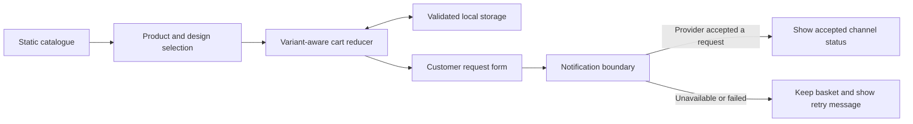

# Trendy Folds

A fashion catalogue with category browsing, search, product designs and a local
shopping cart. The catalogue is committed data; images are served from Cloudinary.
Checkout collects a request, but this repository does not contain an order database,
inventory reservation or payment integration.


Built with Next.js 15, React 19, TypeScript and Tailwind CSS.

## Try the catalogue

Use Node 22:

```bash
npm ci --ignore-scripts
npm run dev
```

Open http://localhost:3000. Browsing and cart updates need no credentials. For a
production-style local run use `npm run build` followed by `npm start`.
`docker compose up --build` defines the container setup on port 3800; container
startup has not been exercised here because the Docker daemon is unavailable.
Native production builds and browser flows were exercised instead.

The default build hides simulated purchase notifications and generated ratings.
`NEXT_PUBLIC_SHOW_SIMULATED_ACTIVITY=true` enables those demonstration components;
they are sample activity, not evidence of real sales or customers.

## Cart behavior

The cart is stored in `localStorage`. A line is identified by product ID **and design
ID**, so increasing or removing one design leaves other designs of the same product
alone. Stored data is validated before use; malformed records are ignored, quantities
are bounded, and prices with multiple separators parse consistently. The initial
storage read completes before the cart is written back.



A client-generated reference is not proof of a durable order. The UI reports a sent
request only when a provider accepts at least one channel, and it reports email and
WhatsApp separately. If nothing is delivered the basket remains available.

## Notification integration

`POST /api/notify` is a server-side integration boundary, not a public email relay.
It requires `Authorization: Bearer <NOTIFICATION_SERVICE_TOKEN>`, limits the request
body to 16 KiB, validates recipients, and bounds provider requests to eight seconds.
Keep this token on a trusted server; never expose it through `NEXT_PUBLIC_*`.

| Server variable | Purpose |
| --- | --- |
| `NOTIFICATION_SERVICE_TOKEN` | Authorizes a trusted server-side order integration |
| `EMAIL_API_KEY`, `EMAIL_SERVICE_URL` | Email provider credentials and endpoint |
| `WHATSAPP_ACCESS_TOKEN`, `WHATSAPP_PHONE_NUMBER_ID` | WhatsApp provider credentials |
| `WHATSAPP_API_URL` | Provider API base URL |

Provider secrets stay outside browser bundles. No live notifications were sent during
verification. A complete production checkout needs a backend that validates the
catalogue, persists an order and calls this integration after that transaction. The
browser demonstration cannot supply the internal token and therefore keeps the basket
when notification delivery is unavailable.

## Checks worth repeating

```bash
npm test
npm run build
```

The regression suite covers independent design quantities/removal, renamed design
metadata, invalid storage, quantity bounds, one notification request per submission,
channel-specific results, provider failures and the authenticated sending boundary.
Provider calls are mocked. The dependency lock uses patched Next.js 15.5.28 and
compatible PostCSS/source-map updates; the production dependency audit reported no
known advisories in the final local check.

## Where to change things

- `src/lib/cart.ts` holds the pure cart rules; `CartContext` connects them to React and storage.
- `src/app/product/[id]` and `src/components/ProductCard.tsx` render product choices.
- `src/lib/notifications.ts` handles the browser request and channel results.
- `src/app/api/notify/route.ts` owns provider access and input limits.
- `src/lib/socialProof.ts` controls simulated activity.
- `scripts/` contains optional asset-preparation tools; they are not part of startup.

The catalogue has no stock source and prices in browser storage are not authoritative
for charging. Cloudinary mappings are maintained by hand. The cart survives a local
reload, but customer requests are not persisted by this application.

## Author

[**Muhammad Nadeem**](https://github.com/dev-mnadeem)
