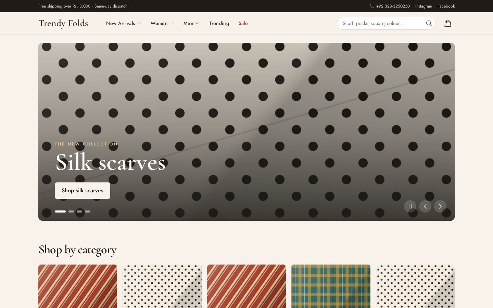
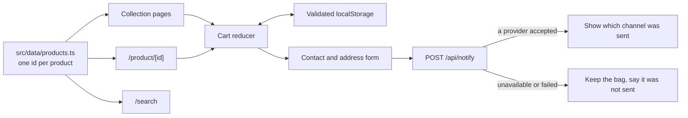
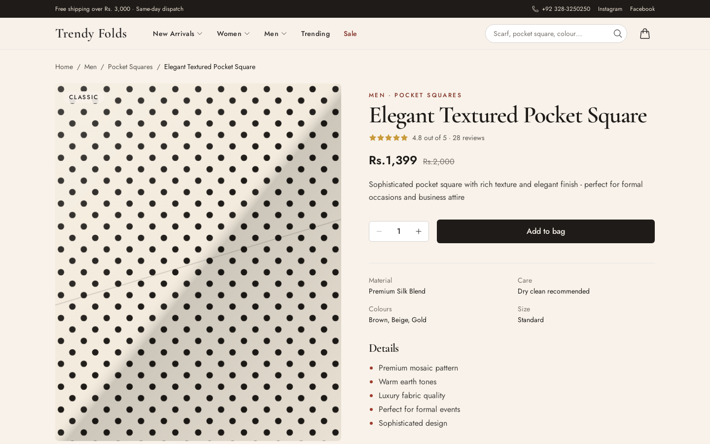
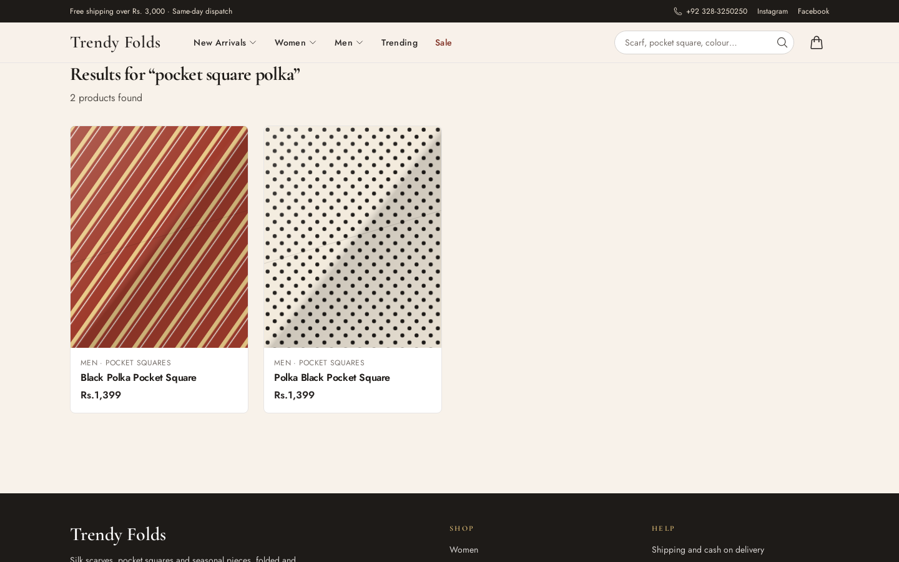
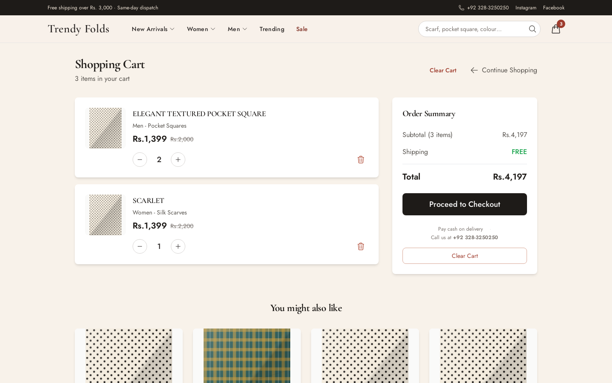
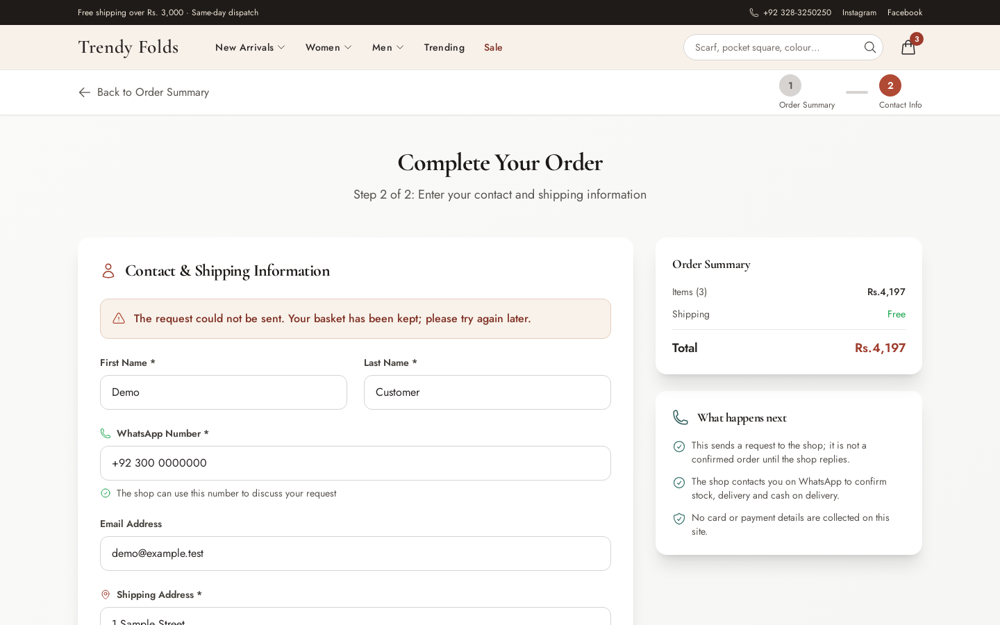
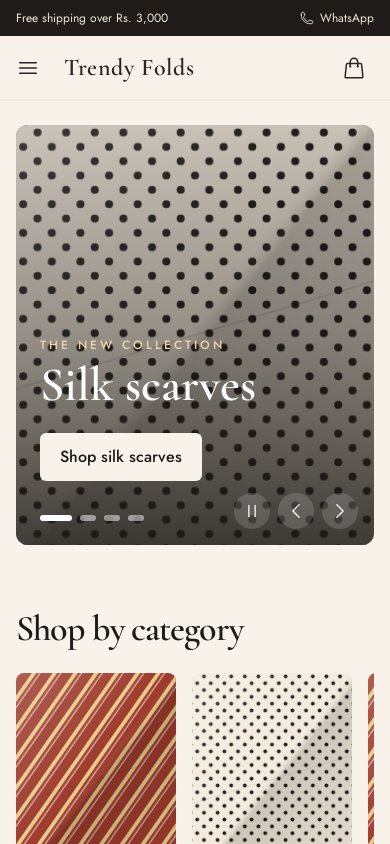
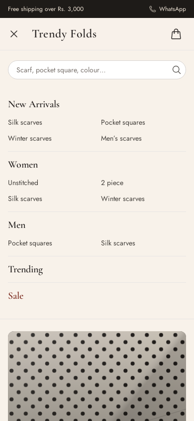
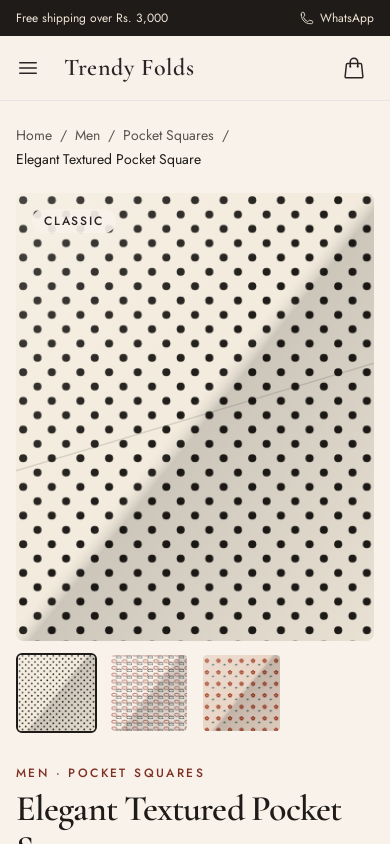

# Trendy Folds

The storefront for a small Pakistani label selling silk scarves, pocket squares and
seasonal pieces. Shoppers browse collections, search the catalogue, keep a bag in their
browser and send an order request that the shop follows up on WhatsApp, with cash on
delivery.

It is a catalogue and request form, not a full shop. There is no order database, no
stock reservation and no payment integration. The request step only succeeds when a
trusted server holds the notification token (see [Order requests](#order-requests));
otherwise the bag is kept and the shopper is told the request was not sent.



Built with Next.js 15 (App Router), React 19, TypeScript and Tailwind CSS 3.

## Run it

Docker is the one-command path; nothing needs credentials to browse.

```bash
docker compose up --build
```

Open http://localhost:3800. The container runs the standalone Next.js server as a
non-root user and reports healthy once the home page answers.

Without Docker, use Node 22 (`.nvmrc`):

```bash
npm ci --ignore-scripts
npm run dev          # http://localhost:3000
```

For a production build, run `npm run build` and then `npm start`. Copy `.env.example`
to `.env.local` to change any setting.

### Product photos

The original product photos are not in this repository. They live in the shop's
Cloudinary account, mapped by hand in `src/lib/image-mapping.ts`.

- With `NEXT_PUBLIC_CLOUDINARY_CLOUD_NAME` empty (the default), every product photo is
  replaced by one of six fabric swatches in `public/images/placeholders/`. The swatch is
  chosen from the photo path, so a product always shows the same one. All the
  screenshots here use these swatches.
- With the cloud name set, mapped photos are served from Cloudinary with resizing in the
  URL, and unmapped ones still fall back to a swatch.

Next.js inlines `NEXT_PUBLIC_` values at build time. With Docker, pass the value as a
build argument: `NEXT_PUBLIC_CLOUDINARY_CLOUD_NAME=… docker compose up --build`.

## How it fits together



- **Catalogue.** `src/data/products.ts` holds every product that a page links to or
  bags, with one store-wide id. Collection pages still keep their own arrays, because the
  sale and new-arrival pages show different prices for the same piece. A test fails if
  any page links to or bags an id the catalogue does not have.
- **Bag.** `src/lib/cart.ts` is a pure reducer. A line is a product id plus an optional
  design id, so two designs of one scarf are separate lines. Quantities are whole numbers
  from 1 to 99. The bag is saved to `localStorage`; stored data is validated on load, and
  the bag pages show a loading state until it has been read.
- **Search.** Every word must match the name, description, style, section or colours.

| | |
|---|---|
|  |  |
|  |  |

On a phone the navigation folds into a menu with its own search:

<p>
  
  
  
</p>

## Order requests

`POST /api/notify` is a server-to-server boundary, not a public email relay. It
requires `Authorization: Bearer <NOTIFICATION_SERVICE_TOKEN>`, accepts at most 16 KiB,
validates the email address and phone number, and gives each provider eight seconds.
Keep the token on a trusted server and never expose it through a `NEXT_PUBLIC_` name.

These responses were captured from a local build with `NOTIFICATION_SERVICE_TOKEN=demo-token`
and no providers configured:

```http
POST /api/notify
Content-Type: application/json

{}

HTTP/1.1 401 Unauthorized
{"error":"Authorization required."}
```

```http
POST /api/notify
Authorization: Bearer demo-token
Content-Type: application/json

{"order":{"orderId":"TF-demo-1","total":"Rs.2,798"},"email":"demo@example.test","phone":"+92 300 0000000"}

HTTP/1.1 200 OK
{"ok":true,"delivered":[],"results":[{"channel":"email","sent":false,"reason":"email is not configured"},{"channel":"whatsapp","sent":false,"reason":"WhatsApp is not configured"}]}
```

```http
POST /api/notify
Authorization: Bearer demo-token

{"order":{},"email":"not-an-email"}

HTTP/1.1 400 Bad Request
{"error":"Valid order and contact details are required."}
```

With no token set the route answers `503`. The browser form cannot supply the token,
so in this repository the request step always ends with the bag kept. That is the
state in the screenshot above. A complete checkout needs a backend that checks prices
against the catalogue, saves the order and then calls this route.

| Server variable | Purpose |
| --- | --- |
| `NOTIFICATION_SERVICE_TOKEN` | Authorizes the trusted server-side integration |
| `EMAIL_API_KEY`, `EMAIL_SERVICE_URL` | Email provider credentials and endpoint |
| `WHATSAPP_ACCESS_TOKEN`, `WHATSAPP_PHONE_NUMBER_ID` | WhatsApp Business credentials |
| `WHATSAPP_API_URL` | Provider API base URL |

No live notifications were sent while building or testing this project.

## Simulated activity

`NEXT_PUBLIC_SHOW_SIMULATED_ACTIVITY=true` turns on two demonstration features: pop-ups
saying an invented customer is looking at a product, and a rating ticker in the header
with invented reviewer names. Both are off by default because they are not real
activity, and presenting them as real would mislead shoppers (`src/lib/socialProof.ts`
explains why).

## Checks

```bash
npm test             # Vitest: 23 tests
npm run lint         # ESLint, also run by next build
npx tsc --noEmit
```

The tests cover the bag (design-specific lines, quantity bounds, invalid storage), the
notification client and route, image resolution with and without Cloudinary, catalogue
lookups and search, and two source scans: every product id a page uses exists in the
catalogue, and every internal link points at a real page or file.

## Where to change things

- `src/data/products.ts`: product records; `src/lib/catalogue.ts`: lookups, sections and search.
- `src/lib/cart.ts`: bag rules; `src/contexts/CartContext.tsx` connects them to React and storage.
- `src/lib/image-mapping.ts`: photo paths to Cloudinary ids, and the swatch fallback.
- `src/lib/notifications.ts` and `src/app/api/notify/route.ts`: the request boundary.
- `src/lib/store.ts`: the shop's phone, WhatsApp and social links.
- `tailwind.config.js`: the palette (ink, paper, madder, saffron, peacock) and the
  Cormorant Garamond and Jost font stacks, bundled through Fontsource.
- `scripts/`: optional image tools (`compress-images.js` uses sharp, `upload-images.js`
  uploads to Cloudinary with `CLOUDINARY_API_KEY`/`CLOUDINARY_API_SECRET` from
  `.env.local`). Neither runs at startup.

## Known limits

- Prices in the browser are not authoritative, and nothing records stock. The sale and
  new-arrival pages carry their own prices for the same products.
- Star ratings and review counts are fixed values in the product data, not collected
  reviews.
- Collection pages other than the home, product and search pages still hold their own
  product arrays and markup; moving them onto the catalogue is the next step.

## License

MIT, see [LICENSE](LICENSE).
